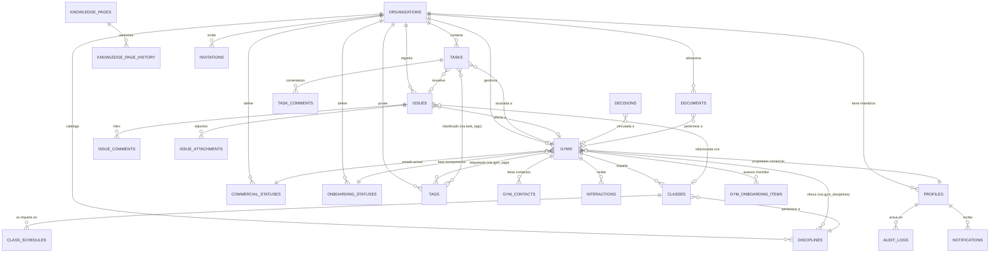
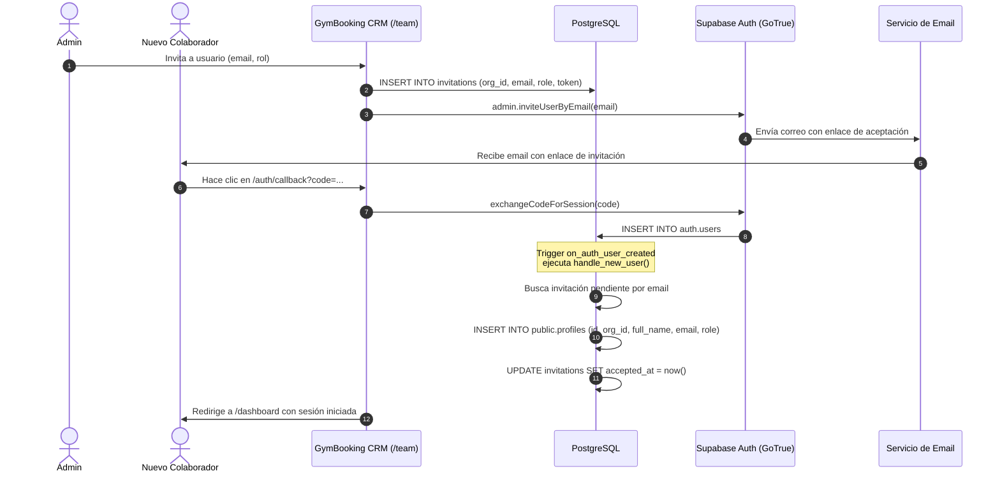

# Arquitectura Técnica — GymBooking Internal CRM

Este documento describe la arquitectura técnica, modelo de datos, diseño de seguridad, flujos de autenticación y decisiones de diseño de **GymBooking Internal**, el sistema central de operaciones y CRM de GymBooking.

---

## 1. Visión General del Sistema

GymBooking Internal está diseñado como una aplicación web modular, multi-inquilino (*multi-tenant* por organización) y segura, que desacopla la lógica de presentación en el frontend (Next.js App Router con React Server Components) de la capa de persistencia y seguridad a nivel de datos (Supabase PostgreSQL con Row Level Security).

### Diagrama de Arquitectura Global

```mermaid
flowchart TB
    subgraph Client["Cliente (Navegador)"]
        UI["UI React 19 (Server & Client Components)"]
        State["Zustand & React Query Cache"]
        ClientAuth["Supabase Browser Client"]
    end

    subgraph NextServer["Next.js Server (Edge & Node.js Runtime)"]
        Middleware["Next.js Middleware (Session Guard)"]
        RSC["React Server Components"]
        API["Route Handlers (/api/*, /auth/callback)"]
        AdminClient["Supabase Server Admin Client (service_role)"]
        UserClient["Supabase Server Client (User Session)"]
    end

    subgraph SupabasePlatform["Supabase Managed Platform"]
        Auth["Supabase GoTrue Auth (Magic Links, Invites)"]
        Postgres[(PostgreSQL 15+ Database)]
        Storage["Supabase Storage (Private 'documents' bucket)"]
        
        subgraph DatabaseEngine["Motor de Base de Datos"]
            RLS["Row Level Security Policies"]
            Triggers["Triggers Automáticos (handle_new_user, audit, notify)"]
            Tables["26+ Tablas Relacionales (Organizaciones, Gimnasios, Clases...)"]
        end
    end

    Client -->|HTTPS / Next Navigation| Middleware
    Middleware --> RSC
    RSC --> UserClient
    UI -->|Mutaciones / Queries| UserClient
    UI -->|Peticiones especiales| API
    API --> AdminClient
    UserClient -->|Queries con JWT de Usuario| RLS
    AdminClient -->|Bypass RLS (Bootstrap, Sync)| Postgres
    RLS --> Tables
    Triggers --> Tables
    ClientAuth -->|Auth Actions| Auth
    Auth -->|AFTER INSERT trigger| Triggers
    UI -->|Carga / Descarga de Archivos| Storage
```

---

## 2. Stack Tecnológico y Justificación

| Tecnología | Rol en el Proyecto | Justificación Técnica |
| :--- | :--- | :--- |
| **Next.js 16 (App Router)** | Framework Fullstack Web | Soporte nativo para Server Actions, React Server Components (RSC) para cargas ultra rápidas sin cascadas de JavaScript, middleware ligero para protección de rutas y optimización de recursos. |
| **React 19** | Biblioteca de UI | Compatibilidad con las últimas APIs de concurrencia, transiciones, `useActionState` y optimizaciones del compilador de React. |
| **TypeScript 5** | Lenguaje de Desarrollo | Seguridad estricta de tipos en todo el ciclo de desarrollo, interoperabilidad garantizada con el esquema de base de datos (`types/database.ts`). |
| **Supabase (PostgreSQL 15+)** | Base de Datos, Auth y Storage | Motor relacional robusto con extensiones avanzadas (`uuid-ossp`, `pg_trgm` para búsqueda de texto trigram), Row Level Security (RLS) nativo, autenticación sin contraseñas y almacenamiento de archivos. |
| **Tailwind CSS v4** | Motor de Estilos | Rendimiento optimizado con compilador Rust/Turbopack, variables CSS nativas y diseño responsivo sin sobrecarga en el bundle de producción. |
| **Radix UI** | Primitivas de Componentes Accesibles | Componentes desacoplados, sin estilos impuestos y totalmente accesibles (WAI-ARIA) para diálogos, desplegables, pestañas y tooltips. |
| **TanStack React Query v5** | Gestión de Estado Asíncrono en Cliente | Caché inteligente, invalidación automática tras mutaciones, deduplicación de peticiones y sincronización en segundo plano para tableros dinámicos. |
| **Zustand** | Estado Global de UI | Biblioteca ultraligera para gestionar estados locales volátiles (filtros del Kanban, paneles laterales, estado de modales) sin boilerplate de Redux. |
| **@dnd-kit** | Drag & Drop | Librería moderna, accesible y fluida para el tablero Kanban del pipeline de gimnasios con soporte táctil y teclado. |
| **TipTap / ProseMirror** | Editor de Texto Enriquecido | Edición modular y extensible para la base de conocimiento interna, minutas de reuniones y notas comerciales. |
| **PapaParse** | Parser CSV | Procesamiento rápido en navegador para la importación y exportación masiva de datos de gimnasios, clases y contactos. |
| **Date-fns** | Manejo de Fechas y Zonas Horarias | Manipulación ligera e inmutable de fechas con soporte completo para la zona horaria `Europe/Madrid`. |

---

## 3. Estructura de Directorios

La estructura del proyecto organiza claramente las capas de presentación, lógica de negocio y configuración:

```
gymbooking-internal/
├── app/                          # Next.js App Router (Rutas y Páginas)
│   ├── (auth)/                   # Grupo de rutas públicas de autenticación
│   │   ├── login/                # Página de inicio de sesión (Magic Link)
│   │   ├── invite/               # Página de aceptación de invitaciones
│   │   └── layout.tsx            # Layout centrado y limpio para auth
│   ├── (dashboard)/              # Grupo de rutas protegidas del CRM
│   │   ├── dashboard/            # Panel general y métricas operativas
│   │   ├── pipeline/             # Tablero Kanban comercial
│   │   ├── gyms/                 # Listado y ficha de gimnasios
│   │   ├── onboarding/           # Gestión del proceso de incorporación
│   │   ├── classes/              # Catálogo de clases y horarios
│   │   ├── issues/               # Módulo de gestión de incidencias
│   │   ├── knowledge/            # Base de conocimiento y documentación
│   │   ├── documents/            # Gestor documental centralizado
│   │   ├── team/                 # Gestión de usuarios, roles e invitaciones
│   │   └── layout.tsx            # Layout con Sidebar, Header y Notificaciones
│   ├── api/                      # Route Handlers de servidor
│   │   ├── bootstrap/            # Inicialización de la primera organización
│   │   └── invitations/          # Validación y gestión de tokens de invitación
│   ├── auth/callback/            # Callback para intercambio de tokens de sesión
│   ├── globals.css               # Estilos globales y tokens del tema
│   └── layout.tsx                # Layout raíz HTML con Providers
├── components/                   # Biblioteca de componentes reutilizables
│   ├── ui/                       # Componentes base basados en Radix UI
│   ├── kanban/                   # Componentes específicos del tablero Kanban
│   ├── forms/                    # Formularios con validación (Zod + Hook Form)
│   ├── navigation/               # Barra lateral, cabecera, migas de pan
│   └── providers.tsx             # Context Providers (React Query, Theme, etc.)
├── docs/                         # Documentación técnica y funcional
│   ├── ARCHITECTURE.md           # Este documento de arquitectura
│   ├── WORKFLOWS.md              # Procesos operativos y de negocio
│   └── DEPLOYMENT.md             # Guía paso a paso de despliegue
├── lib/                          # Utilidades y configuración de librerías
│   ├── auth/                     # Helpers de verificación de roles y permisos
│   │   └── permissions.ts        # Matriz RBAC y guardas de navegación
│   ├── supabase/                 # Clientes Supabase
│   │   ├── client.ts             # Cliente para Client Components (Browser)
│   │   └── server.ts             # Cliente SSR y cliente Admin con service_role
│   └── utils.ts                  # Formateadores, helpers de clases (cn)
├── scripts/                      # Scripts de automatización y administración
│   └── bootstrap.ts              # Script CLI para bootstrap del sistema
├── supabase/                     # Configuración y migraciones de base de datos
│   ├── migrations/               # Migraciones SQL secuenciales
│   │   ├── 001_schema.sql        # Esquema de tablas e índices
│   │   ├── 002_functions.sql     # Funciones PL/pgSQL y triggers
│   │   ├── 003_rls.sql           # Políticas de Row Level Security
│   │   └── 004_seed_statuses.sql # Función de siembra de datos iniciales
│   └── seed.sql                  # Datos de prueba para desarrollo local
├── types/                        # Definiciones de tipos TypeScript
│   └── database.ts               # Tipos autogenerados desde Supabase
├── middleware.ts                 # Middleware de Next.js para protección de rutas
├── package.json                  # Dependencias y scripts del proyecto
└── tsconfig.json                 # Configuración estricta de TypeScript
```

---

## 4. Esquema de Base de Datos y Relaciones

El esquema relacional cuenta con 26 tablas organizadas por dominios de negocio. Todas las tablas cuentan con aislamiento multinquilino (`organization_id`), identificadores UUIDv4 y control de timestamps.



### Agrupación Funcional de las 26 Tablas:

#### A. Núcleo y Multi-inquilino
1. `organizations`: Entidad raíz del inquilino (nombre, slug único).
2. `profiles`: Datos de usuario extendidos (nombre, email, rol, estado activo), vinculados 1:1 con `auth.users`.
3. `invitations`: Invitaciones pendientes para nuevos miembros del equipo con token seguro y fecha de expiración.

#### B. Catálogos y Configuración de Negocio
4. `commercial_statuses`: Fases dinámicas del pipeline de ventas (orden, color, bandera `is_pipeline_stage`).
5. `onboarding_statuses`: Estados del ciclo de incorporación y activación técnica.
6. `disciplines`: Catálogo de deportes y disciplinas (Yoga, Pilates, CrossFit, etc.).
7. `tags`: Etiquetas transversales de color para categorización ágil.

#### C. Gimnasios y CRM
8. `gyms`: Tabla central con datos legales, de contacto, geolocalización, seguimiento comercial, condiciones económicas y fechas de activación.
9. `gym_disciplines`: Relación muchos a muchos entre gimnasios y disciplinas.
10. `gym_tags`: Relación muchos a muchos entre gimnasios y etiquetas.
11. `gym_contacts`: Personas de contacto en el gimnasio (cargo, teléfono, email, si es tomador de decisiones o contacto principal).
12. `interactions`: Registro histórico de llamadas, reuniones presenciales, correos, WhatsApp y compromisos adquiridos.

#### D. Tareas y Onboarding
13. `tasks`: Tareas internas operativas con prioridad, fecha límite y asignación a miembros del equipo.
14. `task_comments`: Discusiones y notas de seguimiento en cada tarea.
15. `task_tags`: Relación muchos a muchos para etiquetar tareas.
16. `onboarding_templates`: Plantillas reutilizables de procesos de incorporación estándar.
17. `onboarding_template_items`: Pasos específicos de cada plantilla clasificados por categoría.
18. `gym_onboarding_items`: Instancia viva del checklist de incorporación para un gimnasio en particular.

#### E. Oferta Deportiva y Horarios
19. `classes`: Clases ofertadas por el gimnasio (aforo, nivel, precio, método de reserva, estado de publicación).
20. `class_schedules`: Horarios semanales recurrentes por día de la semana, hora de inicio/fin y zona horaria.

#### F. Gestión de Calidad e Incidencias
21. `issues`: Tickets de incidencias operativas, errores de datos o problemas técnicos.
22. `issue_comments`: Hilos de comentarios y respuestas de soporte interno.
23. `issue_attachments`: Metadatos de archivos adjuntos (pantallazos, logs) almacenados en Storage.

#### G. Gestión Documental, Conocimiento y Decisiones
24. `documents`: Repositorio documental con control de visibilidad por rol y enlaces polimórficos a entidades.
25. `knowledge_pages`: Artículos y procedimientos internos con historial de versiones en `knowledge_page_history`.
26. `decisions`: Registro formal de decisiones de arquitectura y negocio (ADRs) con contexto, justificación y consecuencias.

*(Tablas transversales complementarias: `comments` genérico, `notifications` y `audit_logs` append-only).*

---

## 5. Filosofía del Diseño de Políticas RLS

La seguridad en GymBooking Internal no delega exclusivamente en los controladores de la aplicación: se implementa **a nivel de fila en el motor PostgreSQL** mediante Row Level Security (RLS). Esto garantiza que, incluso ante un fallo en el código de frontend, ningún usuario pueda filtrar datos de otra organización ni realizar acciones fuera de su rol.

### Principios Fundamentales de RLS:

1. **Aislamiento Estricto de Organización (Multi-tenancy)**:
   Toda consulta sobre tablas de la organización ejecuta la función SQL auxiliar:
   ```sql
   get_user_organization_id()
   ```
   Cualquier fila perteneciente a otra organización es completamente invisible.
2. **Principio de Mínimo Privilegio**:
   Los usuarios con rol `viewer` solo disponen de políticas de lectura (`FOR SELECT`). No pueden insertar, actualizar ni borrar registros.
3. **Escritura Controlada por Rol**:
   Las operaciones de escritura en gimnasios, contactos e interacciones comprueban la función:
   ```sql
   can_write() -- True solo para 'admin', 'commercial', 'operations'
   ```
4. **Operaciones Destructivas Restringidas**:
   El borrado físico (`FOR DELETE`) en entidades principales (gimnasios, tareas, incidencias) está reservado de forma exclusiva a usuarios con rol `admin` (`is_admin()`).
5. **Visibilidad Segmentada de Documentos**:
   La tabla `documents` cuenta con una política de selección condicional según la columna `visibility`:
   - `all`: Visible para cualquier miembro de la organización.
   - `admin_only`: Solo administradores.
   - `commercial`: Administradores y comerciales.
   - `operations`: Administradores y miembros de operaciones.

---

## 6. Flujo de Autenticación y Ciclo de Usuario

El sistema prescinde de contraseñas tradicionales para minimizar vectores de ataque y simplificar el acceso mediante enlaces mágicos (*Magic Links*) gestionados por Supabase Auth:



---

## 7. Sistema de Roles y Matriz de Permisos (RBAC)

El archivo `lib/auth/permissions.ts` define la lógica de control de acceso basada en roles:

| Módulo / Acción | Admin (`admin`) | Comercial (`commercial`) | Operaciones (`operations`) | Observador (`viewer`) |
| :--- | :---: | :---: | :---: | :---: |
| **Gimnasios (Crear / Editar)** | :white_check_mark: | :white_check_mark: | :white_check_mark: | :x: |
| **Gimnasios (Eliminar)** | :white_check_mark: | :x: | :x: | :x: |
| **Pipeline Kanban** | :white_check_mark: | :white_check_mark: | :white_check_mark: | :eyes: (Solo lectura) |
| **Interacciones Comerciales** | :white_check_mark: | :white_check_mark: | :white_check_mark: | :eyes: (Solo lectura) |
| **Checklist Onboarding** | :white_check_mark: | :white_check_mark: | :white_check_mark: | :eyes: (Solo lectura) |
| **Catálogo de Clases / Horarios** | :white_check_mark: | :white_check_mark: | :white_check_mark: | :eyes: (Solo lectura) |
| **Incidencias (Crear / Resolver)**| :white_check_mark: | :white_check_mark: | :white_check_mark: | :eyes: (Solo lectura) |
| **Documentos Privados / Admin** | :white_check_mark: | :x: | :x: | :x: |
| **Documentos Comerciales** | :white_check_mark: | :white_check_mark: | :x: | :x: |
| **Documentos Operaciones** | :white_check_mark: | :x: | :white_check_mark: | :x: |
| **Gestión de Equipo / Invitaciones**| :white_check_mark: | :x: | :x: | :x: |
| **Configuración de Estados / Pipeline**| :white_check_mark: | :x: | :x: | :x: |
| **Consultar Logs de Auditoría** | :white_check_mark: | :x: | :x: | :x: |

---

## 8. Rutas de API y Endpoints de Servidor

| Ruta | Método | Nivel de Acceso | Descripción |
| :--- | :---: | :--- | :--- |
| `/api/bootstrap` | `POST` | Público (Solo 1 ejecución) | Inicializa la primera organización, siembra catálogos y crea la invitación del primer superadministrador. |
| `/api/invitations/[token]` | `GET` | Público con token | Valida si un token de invitación sigue vigente, no ha expirado y no ha sido aceptado con anterioridad. |
| `/auth/callback` | `GET` | Público con token de Auth | Valida el código temporal de Supabase Auth, intercambia la sesión e inicia las cookies seguras de navegación. |

---

## 9. Flujo de Carga y Descarga de Archivos (Supabase Storage)

Los contratos, acuerdos, documentos de onboarding y pantallazos de incidencias se almacenan en Supabase Storage:

1. **Bucket Privado (`documents`)**: Configurado con RLS activado.
2. **Estructura de Almacenamiento**:
   ```
   documents/{organization_id}/{gym_id}/{uuid}-{nombre_archivo}
   ```
3. **Control de Metadatos**:
   Al subirse un archivo, se registra en la tabla `documents` o `issue_attachments` su `storage_path`, tamaño en bytes, `content_type` y nivel de visibilidad.
4. **Descargas Seguras**:
   Los clientes nunca reciben una URL pública directa permanente. El servidor genera una **URL firmada temporal (*Signed URL*)** válida durante 60 segundos tras verificar que el usuario actual cumple la política de visibilidad correspondiente.

---

## 10. Sistema de Notificaciones

El sistema incluye notificaciones internas en tiempo real basadas en triggers de base de datos en PostgreSQL:

- **Asignación de Tareas**: El trigger `notify_task_assigned` detecta cambios en `tasks.assignee_id` o variaciones en la fecha límite (`due_date`) e inserta una notificación dirigida al usuario responsable.
- **Incidencias Urgentes**: El trigger `notify_urgent_issue` avisa de forma inmediata al asignado cuando una incidencia se crea o eleva a prioridad `urgent`.
- **Deduplicación Automática**: La función `create_notification()` comprueba que no exista ya una notificación no leída del mismo tipo y entidad creada en la última hora, evitando sobrecargar la interfaz del usuario.

---

## 11. Sistema de Auditoría (Audit Logs)

La trazabilidad de cambios críticos es esencial para resolver disputas y mantener la integridad comercial:

- **Tabla Append-Only (`audit_logs`)**:
  Registra `actor_user_id`, `entity_type`, `entity_id`, `action` (`CREATE`, `UPDATE`, `DELETE`, `STAGE_CHANGE`), junto con snapshots en formato JSONB de `old_values` y `new_values`, así como la dirección IP.
- **Inmutabilidad Absoluta**:
  La tabla no dispone de políticas SQL para `UPDATE` ni para `DELETE`. Ni siquiera un administrador mediante la interfaz puede borrar o alterar una entrada de auditoría.
- **Acceso Exclusivo de Lectura**:
  Solo los usuarios con rol `admin` tienen permiso para consultar los logs de auditoría de su organización.

---

## 12. Decisiones Clave de Diseño y Racional Técnico

### 1. ¿Por qué los estados comerciales (`commercial_statuses`) residen en Base de Datos?
*Alternativa considerada*: Tipos enumerados de PostgreSQL (`CREATE TYPE commercial_status AS ENUM (...)`) o constantes estáticas en TypeScript.
*Decisión y justificación*: Los procesos de venta evolucionan rápidamente. Mantener los estados en la base de datos permite a los administradores crear nuevas etapas de prospección, reordenar columnas del Kanban, pausar estados obsoletos y modificar colores identificativos desde la pantalla de configuración sin requerir despliegues de código ni migraciones de esquema complejas.

### 2. ¿Por qué `audit_logs` no tiene política de DELETE?
*Decisión y justificación*: Para garantizar el no repudio y el cumplimiento normativo. Si un usuario con credenciales privilegiadas pudiera borrar registros de auditoría, se perdería la evidencia de cambios sensibles (modificación de comisiones, bajas de gimnasios o reasignaciones).

### 3. ¿Por qué el alta de perfiles utiliza el trigger `handle_new_user`?
*Alternativa considerada*: Crear el perfil en el frontend dentro del componente tras registrarse.
*Decisión y justificación*: La creación en frontend es susceptible de errores de red, cierres de pestaña anticipados o condiciones de carrera que dejan al usuario creado en `auth.users` pero sin perfil en `public.profiles`. El trigger de PostgreSQL garantiza **consistencia transaccional ACID**: el perfil y la aceptación de la invitación se materializan de forma atómica e infalible en la misma transacción de base de datos.

### 4. ¿Por qué separar el estado comercial del estado de onboarding?
*Decisión y justificación*: Un gimnasio tiene dos dimensiones operativas distintas:
- **Dimensión Comercial (`commercial_status`)**: Refleja el embudo de ventas (contacto, negociación, acuerdo verbal, formalización de contrato). El responsable es el comercial.
- **Dimensión de Incorporación (`onboarding_status`)**: Refleja el trabajo técnico y operativo una vez acordada la colaboración (recopilación de horarios, validación de clases, prueba del sistema de reservas, autorización de publicación). El responsable es operaciones.
Mezclar ambos estados en un único campo generaba bloqueos: un gimnasio podía tener el contrato firmado (éxito comercial) pero estar a la espera de que el dueño enviara los horarios (onboarding pendiente). Al separarlos, cada equipo tiene su propio tablero y métricas de rendimiento independientes.
