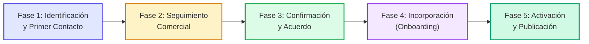
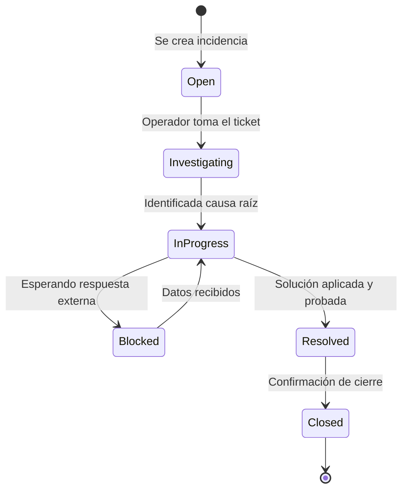

# Guía de Flujos de Trabajo — GymBooking Internal CRM

Este documento detalla los procesos operativos, comerciales y técnicos del equipo de GymBooking. Define las mejores prácticas y procedimientos estándar (SOPs) para gestionar gimnasios, interacciones, el pipeline de ventas, incorporación de centros e incidencias.

---

## Índice

1. [Proceso Completo de un Gimnasio (Ciclo de Vida E2E)](#1-proceso-completo-de-un-gimnasio-ciclo-de-vida-e2e)
2. [Cómo Registrar una Interacción Comercial](#2-cómo-registrar-una-interacción-comercial)
3. [Cómo Gestionar el Pipeline Kanban](#3-cómo-gestionar-el-pipeline-kanban)
4. [Proceso de Incorporación (Checklist de Onboarding)](#4-proceso-de-incorporación-checklist-de-onboarding)
5. [Cómo Gestionar Incidencias](#5-cómo-gestionar-incidencias)
6. [Cómo Invitar a un Nuevo Miembro del Equipo](#6-cómo-invitar-a-un-nuevo-miembro-del-equipo)
7. [Cómo Exportar e Importar Datos](#7-cómo-exportar-e-importar-datos)

---

## 1. Proceso Completo de un Gimnasio (Ciclo de Vida E2E)

El viaje de un gimnasio en la plataforma atraviesa cinco fases consecutivas, transitando desde la prospección comercial inicial hasta su publicación activa en el marketplace público de GymBooking.

---

### Fase 1: Identificación y Primer Contacto
- **Objetivo**: Detectar centros deportivos potenciales de alta calidad, registrar sus datos esenciales en el CRM y realizar el primer acercamiento.
- **Responsable**: Equipo Comercial (`commercial`).
- **Pasos a seguir**:
  1. **Alta del Lead**: Pulsar en el botón **+ Nuevo Gimnasio** desde el CRM o el Kanban.
  2. **Datos Mínimos Obligatorios**:
     - Nombre comercial del gimnasio.
     - Ciudad y dirección física.
     - Teléfono y/o correo de contacto.
     - Disciplinas principales (Yoga, Pilates, CrossFit, etc.).
     - Fuente de contacto (`contact_source`): Prospección propia, recomendación, Instagram, etc.
  3. **Contacto Principal**: Crear al menos un contacto en la pestaña *Contactos* indicando nombre, cargo y si es el tomador de decisiones (`is_decision_maker`).
  4. **Estado Inicial**: Se clasifica como `Identificado` o `Pendiente de primer contacto`.
  5. **Primer Toque**: Realizar una llamada o enviar mensaje de presentación vía WhatsApp/email corporativo y registrar la interacción. El estado pasa a `Contactado`.

---

### Fase 2: Seguimiento Comercial
- **Objetivo**: Despertar el interés del gestor del gimnasio, presentar el modelo de negocio de GymBooking, resolver objeciones y agendar una demo o reunión.
- **Responsable**: Propietario comercial asignado (`owner_id`).
- **Pasos a seguir**:
  1. **Actualización de Estado**: Según la respuesta, mover en el pipeline a `Esperando respuesta`, `Interesado` o `Reunión pendiente`.
  2. **Nivel de Interés**: Calificar en la ficha del gimnasio el campo `interest_level` (`low`, `medium`, `high`, `very_high`) y detallar el motivo en `interest_reason`.
  3. **Reunión Comercial**: Realizar la videollamada o visita presencial. Tras concluir, registrar la interacción con el resumen, puntos tratados y objeciones identificadas (`gym_objections`).
  4. **Programación del Siguiente Paso**: Rellenar siempre `next_followup_date` y `next_action` (ej. "Llamar el jueves para comentar dudas sobre comisión").

---

### Fase 3: Confirmación y Condiciones Comerciales
- **Objetivo**: Cerrar las condiciones económicas del acuerdo y formalizar el compromiso de adhesión.
- **Responsable**: Equipo Comercial (`commercial`) con visto bueno de `admin`.
- **Pasos a seguir**:
  1. **Definición de Condiciones**:
     - **Modelo propuesto / acordado**: Comisión por reserva completada, cuota mensual o modelo mixto.
     - **Gestor de Reservas**: Quién confirmará la plaza (`gym`, `gymbooking`, `mixed`).
     - **Política de Cancelación**: Plazo límite sin penalización para el usuario (ej. 12 horas antes).
  2. **Registro de Estado**: Pasar a `Confirmado verbalmente` y, cuando se reciba el contrato firmado o confirmación por email, a `Acuerdo formalizado`.
  3. **Adjuntar Documentación**: Subir el contrato o propuesta firmada a la pestaña de *Documentos* con categoría `agreements` o `commercial_proposals`.
  4. **Traspaso a Operaciones**: Marcar la fecha de confirmación (`confirmation_date`) y notificar al equipo de operaciones para iniciar el onboarding.

---

### Fase 4: Incorporación (Onboarding Técnico y Operativo)
- **Objetivo**: Recopilar y verificar toda la información necesaria para cargar el gimnasio en la plataforma con total fidelidad.
- **Responsable**: Responsable de Onboarding (`onboarding_owner_id`) / Equipo de Operaciones (`operations`).
- **Pasos a seguir**:
  1. **Generación del Checklist**: El sistema asocia automáticamente la plantilla estándar de onboarding en la tabla `gym_onboarding_items`.
  2. **Fase de Recopilación**: Pasar el estado de onboarding a `Recopilando información`. Solicitar al gimnasio:
     - Parrilla oficial de horarios y nombres de las clases.
     - Aforo por sesión y descripción de niveles.
     - Fotografías del centro y material.
     - Datos fiscales y bancarios para liquidaciones.
  3. **Carga y Validación de Clases**:
     - Dar de alta cada clase en la pestaña *Clases* (`classes`).
     - Configurar sus horarios recurrentes (`class_schedules`).
     - Verificar que los precios y duraciones coinciden con el acuerdo.
  4. **Resolución de Bloqueos**: Si el gimnasio no contesta o faltan datos críticos, marcar los ítems correspondientes como `blocked` y registrar el motivo en `current_blockers`.

---

### Fase 5: Activación y Publicación
- **Objetivo**: Autorizar y publicar el gimnasio y su oferta deportiva en la app/web pública de GymBooking.
- **Responsable**: Equipo de Operaciones (`operations`) y Administrador (`admin`).
- **Pasos a seguir**:
  1. **Control de Calidad (QA)**:
     - Verificar que el 100% de los ítems del checklist de onboarding están en estado `completed`.
     - Revisar que las clases están en estado `verified` por un operador.
  2. **Autorización Interna**: Marcar la publicación autorizada en el checklist.
  3. **Activación**:
     - Cambiar el estado de onboarding a `Activo` (`active`).
     - Establecer la fecha de activación real (`activation_date_real = now()`).
     - Marcar las clases como `published`.
  4. **Comunicación al Centro**: Enviar email formal de bienvenida al gimnasio informando de que su perfil ya está disponible para recibir reservas.

---

## 2. Cómo Registrar una Interacción Comercial

El registro exhaustivo de interacciones es obligatorio tras cualquier contacto con un centro para preservar la memoria colectiva del equipo.

### Pasos:
1. Accede a la ficha del gimnasio y abre la pestaña **Interacciones**.
2. Pulsa en **+ Nueva Interacción**.
3. Cumplimenta los campos del modal:
   - **Tipo**: `call` (llamada), `email`, `whatsapp`, `meeting_in_person`, `video_call`, o `internal_note`.
   - **Contacto relacionado**: Selecciona a la persona con la que se mantuvo la conversación.
   - **Fecha y Hora**: Momento exacto en que ocurrió la interacción.
   - **Resumen (`summary`)**: Síntesis clara y directa de los puntos clave tratados.
   - **Resultado (`outcome`)**: Conclusión o acuerdo preliminar alcanzado.
   - **Compromisos (`commitments`)**: Qué prometió GymBooking y qué prometió el gimnasio.
   - **Próximo Paso y Fecha (`next_step` y `next_step_date`)**: Tarea a realizar para continuar el avance.
4. Pulsa en **Guardar Interacción**.

> **Regla de Oro**: Ningún gimnasio en prospección debe quedar sin una fecha de siguiente seguimiento (`next_followup_date`) asignada.

---

## 3. Cómo Gestionar el Pipeline Kanban

El tablero Kanban (`/pipeline`) ofrece una panorámica visual en tiempo real de todos los gimnasios organizados por columnas según su `commercial_status`.

### Dinámica del Tablero:
1. **Arrastrar y Soltar (*Drag & Drop*)**: Mueve las tarjetas de un gimnasio entre columnas para actualizar su estado automáticamente en base de datos.
2. **Filtros Avanzados**:
   - **Por Comercial Asignado**: Permite aislar tu cartera de gimnasios.
   - **Por Disciplina**: Filtra centros que imparten Yoga, Boxeo, etc.
   - **Por Prioridad**: Focaliza esfuerzos en gimnasios `urgent` o `high`.
   - **Buscador en Vivo**: Búsqueda instantánea por nombre o ciudad mediante índices trigram.
3. **Indicadores en la Tarjeta**:
   - Etiqueta de prioridad de color.
   - Días transcurridos desde el último contacto.
   - Alerta roja si la fecha de seguimiento (`next_followup_date`) ha vencido.
   - Responsable asignado con avatar.

---

## 4. Proceso de Incorporación (Checklist de Onboarding)

El módulo de onboarding garantiza que ningún gimnasio se publique sin haber completado todos los requisitos de calidad técnica y operativa.

### Lista de Control Estándar (15 Pasos):
1. Confirmación comercial registrada.
2. Persona de contacto principal identificada.
3. Condiciones comerciales documentadas.
4. Acuerdo formalizado (si procede).
5. Información del gimnasio verificada (nombre, CIF, teléfono).
6. Dirección y datos de localización geográfica confirmados.
7. Disciplinas deportivas confirmadas.
8. Horarios y clases recibidos en plantilla oficial.
9. Precios y condiciones de las clases comprobados.
10. Disponibilidad y sistema de reservas definido.
11. Procedimiento de cancelaciones documentado.
12. Información cargada en la plataforma GymBooking.
13. Clases revisadas por el equipo de operaciones.
14. Publicación formal autorizada.
15. Gimnasio activado y publicado.

Cada ítem puede tener estados `pending`, `in_progress`, `completed` o `blocked`. Si un ítem se bloquea, debe añadirse un comentario explicativo indicando la causa y la solución esperada.

---

## 5. Cómo Gestionar Incidencias

El módulo de incidencias (`/issues`) gestiona reclamaciones, problemas técnicos o descuadres de horarios.

### Ciclo de Vida de una Incidencia:

### Priorización y Notificaciones:
- **Urgente (`urgent`)**: Interrupción del servicio de reservas, cobros erróneos o cancelación inesperada de clases. Dispara una notificación inmediata al asignado.
- **Alta (`high`)**: Horarios desactualizados en la app que confunden a los usuarios.
- **Media (`medium`)**: Dudas operativas del gimnasio, cambios de datos de contacto.
- **Baja (`low`)**: Peticiones de mejoras menores o ajustes cosméticos.

---

## 6. Cómo Invitar a un Nuevo Miembro del Equipo

Solo los usuarios con rol `admin` tienen permiso para invitar nuevos colaboradores.

1. Navega a **Equipo** (`/team`) en la barra lateral.
2. Pulsa en **Invitar Usuario**.
3. Rellena los datos:
   - **Correo Electrónico**: Email corporativo del colaborador.
   - **Rol a Asignar**:
     - `commercial`: Si se incorpora al equipo de ventas y prospección.
     - `operations`: Si trabajará en onboarding, clases e incidencias.
     - `viewer`: Si es un analista o inversor que solo requiere visualización.
     - `admin`: Si asumirá tareas de administración y configuración global.
4. Pulsa en **Enviar Invitación**.
5. El colaborador recibirá un correo con un enlace mágico válido durante 7 días. Al hacer clic, su cuenta quedará vinculada automáticamente a la organización.

---

## 7. Cómo Exportar e Importar Datos

### Exportación a CSV:
- En las vistas de **Gimnasios**, **Contactos** o **Incidencias**, pulsa en el botón **Exportar CSV**.
- La plataforma procesa los datos filtrados en tiempo real mediante `PapaParse` y descarga un archivo `.csv` compatible con Microsoft Excel y Google Sheets.

### Importación Masiva de Gimnasios:
- En la sección **Gimnasios**, haz clic en **Importar CSV**.
- Descarga la plantilla CSV recomendada para asegurar que las columnas (`name`, `city`, `phone`, `email`, `disciplines`) coincidan con los nombres esperados.
- Sube el archivo completado. El sistema validará los campos y creará los registros en bloque dentro de tu organización.
